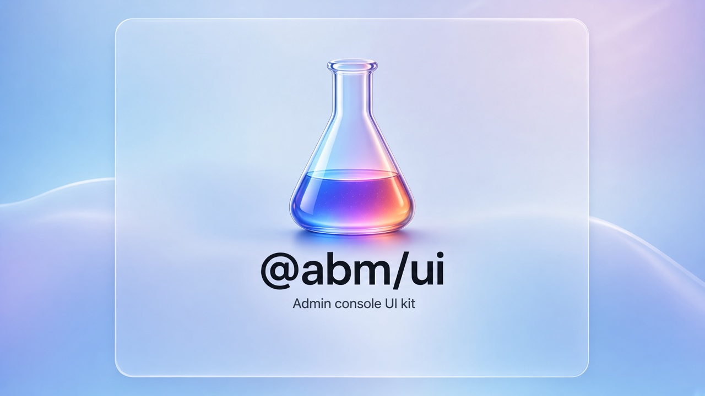
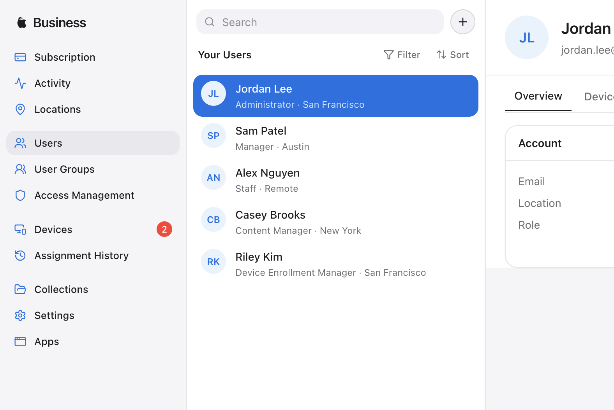
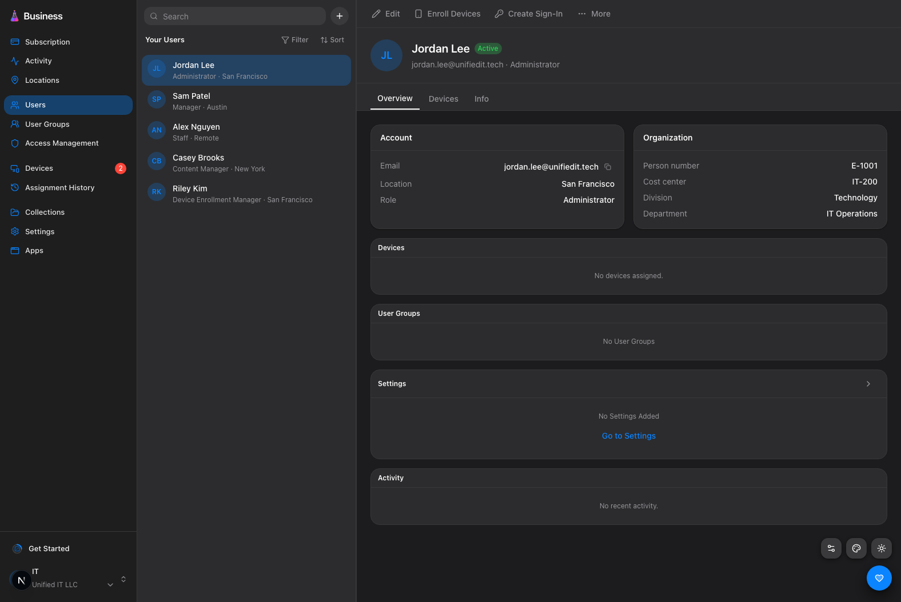
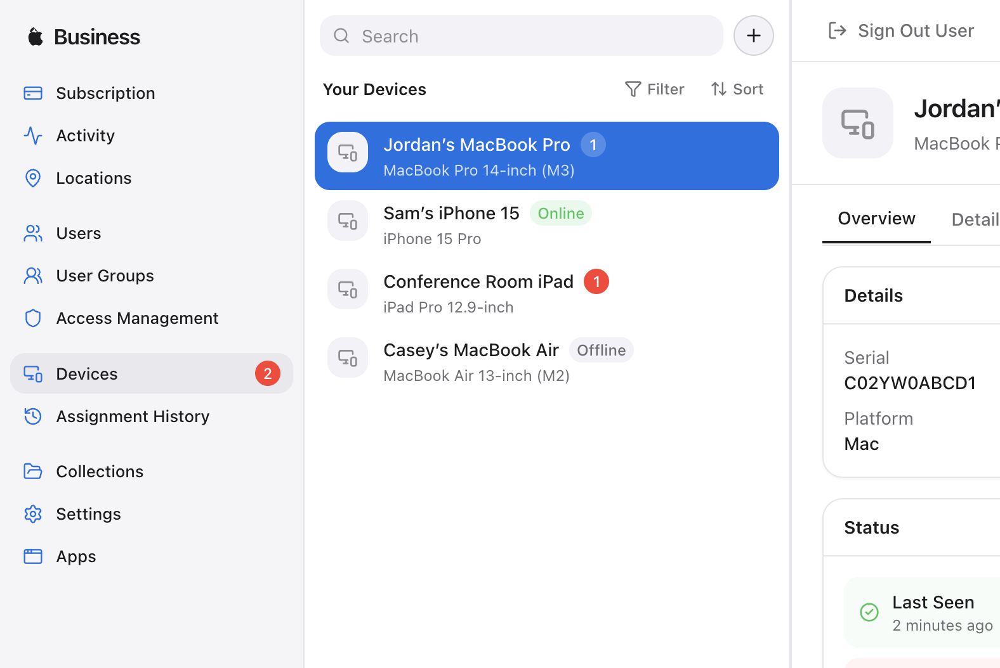
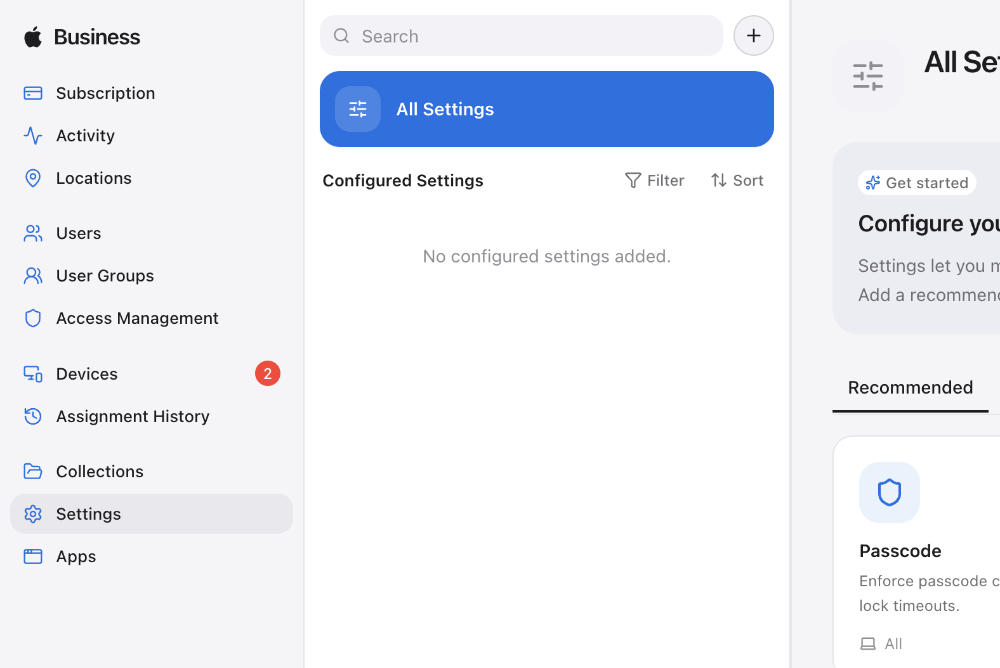
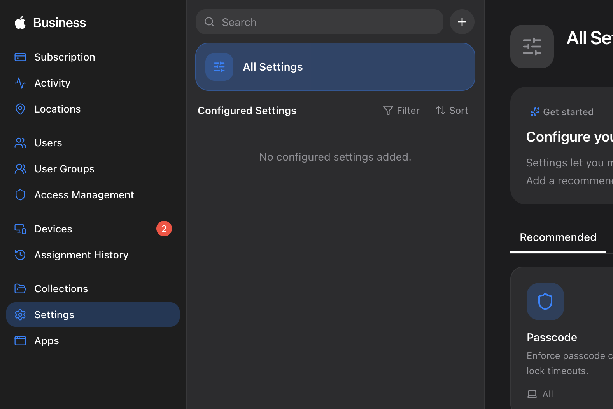
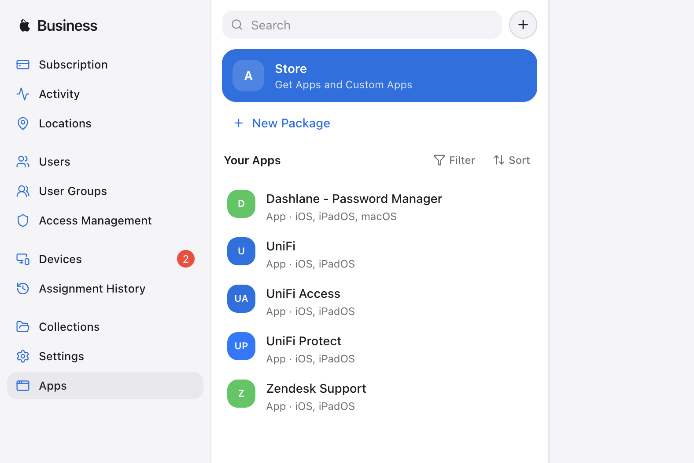

# Business Manager Admin Console (POC)



Reusable admin-console UI kit and demo app inspired by Apple Business Manager’s device and user management UX.

**Package:** `@abm/ui` · **Maintained on GitHub only** (no registry or design-system server).  
See **[CONSUMING.md](./CONSUMING.md)** for install via git tag, peer deps, Tailwind wire-up, and the PR checklist.

```bash
npm install git+https://github.com/sagar290/abm-ui-components.git#1.4.0
```

Current kit tag: **`1.4.0`** (semver: `1.0.0` … `1.4.0`, …). Living catalog: `/design-system` in this app, or optional GitHub Pages (see below).

## Support

If this kit helps your project, you can sponsor via:

[](https://buy.polar.sh/polar_cl_0WgX5W8w1NAg4quzE0uckh8Ib4yN01PuoewKc2NL0ys)
[](https://wise.com/pay/r/cwvY1WWWGbRmCqs)

Thank you.

## Screenshots

### Users





### Devices



### Settings





### Apps



## Stack

- **Next.js** (App Router) + TypeScript (strict)
- **Tailwind CSS v4** design tokens (`styles/tokens.css`, imported from `app/globals.css`)
- **Radix UI** (dialog, select, tabs, checkbox, toast, tooltip, popover)
- **lucide-react**, **class-variance-authority**, **clsx**, **tailwind-merge** (`cn()` in `lib/utils.ts`)
- Mock data only — no backend

## Setup

```bash
npm install
npm run dev
```

Open [http://localhost:3000](http://localhost:3000) (redirects to `/users`).

| Script        | Description              |
|---------------|--------------------------|
| `npm run dev` | Development server       |
| `npm run build` | Production build       |
| `npm run start` | Start production server|
| `npm run lint`  | ESLint                 |

## Architecture

```
/app                    Routes (compose only — no raw controls)
/components/ui          Reusable primitives & shell chrome
/components/features    Screen-level compositions (Users, Devices, Settings)
/lib                    utils, mock-data, console-store
/types                  Shared TypeScript types
```

**Component reuse rules** are enforced in `AGENTS.md`. Pages and features may only compose `/components/ui` components.

### Three-pane shell

`AppShell` + `Sidebar` + `ListPane` + `DetailPane`:

1. Left nav (with alert badges, Get Started checklist, org switcher)
2. Middle searchable list
3. Right detail (toolbar, header, tabs, sections)

On small screens, panes collapse with a menu / back button.

### Client state

`ConsoleProvider` (`lib/console-store.tsx`) holds users, devices, configured settings, checklist, and org. Adding a setting that remediates an issue clears matching device issues (e.g. Firewall → device “Firewall Off”).

## Key routes

| Route | Description |
|-------|-------------|
| `/users`, `/users/[id]` | User list, add account modal, enroll devices |
| `/devices`, `/devices/[id]` | Device list with issue badges, erase confirm, status Fix links |
| `/settings` | Settings catalog + configured list; remediates device issues |
| `/design-system` | Living catalog of every UI component/variant |
| Other nav items | Placeholder “coming soon” pages |

## How to add a new resource page (e.g. Groups)

1. **Types & mock data** — add `Group` to `types/index.ts` and seed data in `lib/mock-data.ts`. Add a nav item if needed.
2. **Feature console** — create `components/features/groups-console.tsx` that composes only UI kit pieces:
   - `ConsoleLayout` + `ListPane` / `ListItem` for the middle pane
   - `DetailPane` + `Tabs` / `SectionCard` / `EmptyState` for detail
   - `Dialog` + `FormField` + `Input` / `Select` for create/edit
   - `ConfirmDialog` for destructive actions
3. **Routes** — add `app/groups/page.tsx` and `app/groups/[id]/page.tsx` that render the feature.
4. **Do not** add raw `<button>` / `<input>` / card markup in the feature. If something is missing, extend an existing UI component or add one to `/components/ui`, export it from `index.ts`, and document it on `/design-system`.
5. Finish with a **Reuse report** (used / extended / new).

## Design tokens & theming

Colors, radius, shadows, and fonts live as CSS variables in `styles/tokens.css` (exported as `@abm/ui/styles.css`). The demo app imports them from `app/globals.css`. Components use token utilities (`bg-surface`, `text-accent`, `rounded-xl`, `shadow-md`) — never hard-coded hex in UI code.

| Concern | How it works |
|---------|----------------|
| Light / dark | Class-based (`html.dark`). Stored as `abm-theme`: `light` \| `dark` \| `system` |
| Style presets | `data-preset` on the root: `normal` \| `glossy` \| `colorful` (`abm-preset`) |
| Custom colors | Optional brand/status/surface overrides (`abm-custom-colors`) via `ThemeCustomizer` |
| Flash avoidance | `themeBootstrapScript` from `@abm/ui/theme` runs before paint |

Shell chrome exposes `ThemeToggle`, `ThemePresetMenu`, and `ThemeCustomizer`. Full controls and token docs live on `/design-system`.

## Releasing the kit

Remote already uses semver tags (`1.0.0` … `1.4.0`, …). Cut the next version on `main`:

```bash
# bump package.json "version", commit, then:
git tag -a 1.5.0 -m "1.5.0: short summary"
git push origin 1.5.0
```

Consumers bump the `#1.x.x` pin. Pushing `main` or a version tag also deploys the optional Pages catalog when Pages is configured as below.

## GitHub Pages (design catalog)

Static export URL: [https://sagar290.github.io/abm-ui-components/design-system/](https://sagar290.github.io/abm-ui-components/design-system/)

**Required settings** (repo → Settings):

1. **Pages → Build and deployment → Source = GitHub Actions**  
   Do not use “Deploy from a branch” (`main` / `/`). That publishes the app source tree, not the Next `out/` export from [`.github/workflows/pages.yml`](./.github/workflows/pages.yml).
2. **Environments → `github-pages` → Deployment branches and tags → No restriction**  
   (or allow branch `main` and tags `*.*.*` / `v*`). If tags are blocked, Actions fails with *Tag "x.y.z" is not allowed to deploy to github-pages*.

Then push to `main`, push a semver tag, or run **Actions → Deploy design catalog to GitHub Pages → Run workflow**.

## Accessibility

- Keyboard focus rings via `:focus-visible` and Radix primitives
- Dialogs trap focus and close on ESC
- Destructive actions are visually separated and confirmed
- Badges and toolbar actions expose accessible names
